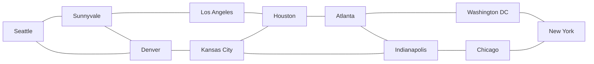

# Abilene LLM-only baseline

The next experiment is the proposal's closed loop without a System One model.
Establish repeatable network and repair measurements first; introduce Jev or Kev
only after this baseline works. Existing screening code is inactive in these trials.

## Topology and provenance

`data/abilene-source.json` records the 11 sites and 14 edges from the Internet
Topology Zoo's Abilene 2005_02 GraphML:
https://raw.githubusercontent.com/sk2/topologyzoo/master/sources/Abilene.graphml

The source graph's listed edges are represented as bidirectional Ethernet links.
Router names are sea, sva, lax, den, kcy, hou, atl, ind, chi, was, and nyc.
One Linux host is attached at each site. This is the source's topology, with
experimental addressing, uniform OSPF costs, Ethernet interfaces, and scaled
capacities. It is not a recreation of historical propagation delays or capacity.



`topologies/abilene.json` is the machine-readable interface/address inventory.
`labs/configs/abilene/*.cfg` are reproducible EOS source configurations.
`labs/abilene.clab.yml` is JSON (valid YAML) and can be used directly by Containerlab.
Router management IPs are 172.30.100.41–51 and host management IPs are
172.30.100.141–151, on the existing advnet-ceos-mgmt network. Router MGMT VRFs
isolate management routing. Hosts have no default route; only the experiment
aggregate 10.64.0.0/16 is routed through their eth1 gateway. Transit links use
10.65.0.0/24 split into /30s. Each host has its own 10.64.N.0/24 subnet.

Regenerate source artifacts deterministically:

```bash
python3 scripts/generate-abilene.py
```

Do not regenerate while manually editing the generated source configs; keep new
scenario changes in the scenario files. Existing runtime configs take precedence
on redeployment. An intentional reset requires destroying this lab with --cleanup
before redeploying, which discards runtime changes.

## 1. Deploy and validate the healthy network

Run commands in your desktop terminal from the project root. Docker requires
either active docker-group membership or sudo. Keep model calls in your normal
user session so API environment variables remain available.

Optionally stop the earlier labs to free resources:

```bash
sudo containerlab destroy -t labs/diamond.clab.yml
sudo containerlab destroy -t labs/ceos-smoke.clab.yml
```

Build the traffic-host image and deploy the new topology:

```bash
sudo docker build -t advnet-host:0.1 labs/hosts
sudo containerlab deploy -t labs/abilene.clab.yml
uv sync --extra openai --extra batfish
sudo .venv/bin/python -m advnet.experiment check --seconds 300
```

The host image includes iproute2, ping, traceroute, and iperf3; it does not change
host system libraries. Each host runs an iperf3 server bound to its data address.
The check waits for routing-table stability, checks the exact expected FULL OSPF
neighbor sets, and pings all 110 directed pairs (three packets each) over eth1.
It returns failure if any pair loses packets or any intended adjacency is missing.
It writes full measurements under runs/ and prints a short summary.

Source generation, contract tests, and fake-network tests can run without Docker.
They do not establish live connectivity. On November 2, 2026, a live Abilene
capture verified all 110 directed host pairs with zero ping loss and all expected
OSPF neighbors FULL. Mean RTT was 5.69 ms. This validates that capture, not a
repair trial or congestion performance.

### Restart after a host or Docker restart

Reconcile the lab with Containerlab so missing data links are recreated:

```bash
sudo containerlab deploy -t labs/abilene.clab.yml
```

Starting the router containers with `docker start` alone can leave only `eth0`
after a host restart. The routers need Containerlab's transit and host-facing
links before EOS and the live collector can work. If reconciliation cannot
recover the lab, recreate the containers from the topology (this restarts all
nodes and regenerates configuration artifacts):

```bash
sudo containerlab deploy -t labs/abilene.clab.yml --reconfigure
```

The local Batfish container is named `advnet-batfish`:

```bash
sudo docker start advnet-batfish
```

To restart an already running Batfish service, use
`sudo docker restart advnet-batfish`. If no container exists yet, create it with
the `docker run` command in section 2. Only port 9996 is needed by this project.

Earlier sudo invocations may have created root-owned experiment files. Restore
the current user's ownership before running the visualizer or trials normally:

```bash
sudo chown -R "$(id -u):$(id -g)" runs
```

After the routers finish booting, verify the lab and start the visualizer:

```bash
sudo .venv/bin/python -m advnet.experiment check --seconds 300
sudo .venv/bin/python -m advnet.visualizer
```

Open http://localhost:8765. If the visualizer is already running, stop its
existing terminal process with Ctrl+C before starting another on the same port.

### Batfish validation on November 5, 2026

The coworker's `feature/diamond-batfish-gate` changes were fast-forwarded into
the local checkout at `3d3b6fc`. Real Batfish accepted the Abilene source snapshot
(11 routers, 11 modeled hosts, all 110 directed ICMP flows accepted on every
modeled path). An offline candidate with Seattle's host-facing interface disabled
was rejected: 20 directed host flows failed with NO_ROUTE or NEIGHBOR_UNREACHABLE.
No fault was deployed to live routers. Reports are saved locally under
`captures/abilene-validation-20261105/`.

After link reconciliation, the Linux hosts still needed their declared data IPs,
10.64.0.0/16 routes, and iperf3 servers restored. Their management default routes
were removed as declared by the topology. A subsequent live sweep passed all
110 directed pairs with zero ping loss, all expected OSPF neighbors FULL, and
mean RTT 5.65 ms. The live visualizer collected 11 configurations and 14 backbone
links. A Seattle-to-New-York traceroute reached its destination with unanswered
intermediate TTLs; these gaps do not establish the intermediate forwarding path.

Chromium checks passed path highlighting, timeline events, persistent probe
errors/retry, replay/diffs, and mobile layout, with no browser errors. These
checks do not establish a completed LLM repair trial. Live observer recording was
subsequently confirmed working during the traffic test, with no telemetry errors.

Captured EOS output included a CLI echo and an unsupported default `system l1`
block. The collector now strips the exact command echo. The verifier preserves
the submitted snapshot and uses a temporary model copy in which only that echo
and the exact default pair `unsupported speed action error` / `unsupported
error-correction action error` are commented. Exclusions are listed by file in
the verifier response. These are [physical configuration guards](https://www.arista.com/jp/um-eos/eos-layer-1-cli-guard-relaxation),
not interface speed settings. Physical guard policy is outside this routing
model; operational links and connectivity are checked live. Unknown L1 commands,
different guard actions, routing/ACL configuration, and interface shutdown state
are not excluded. The strict parse and initialization checks remain active.

To run the complete suite including the real Batfish controller test while
keeping its evidence in a writable directory:

```bash
RUN_BATFISH_INTEGRATION=1 ADVNET_TEST_OUTPUT_DIR=captures/batfish-integration \
  .venv/bin/python -m unittest discover -s tests
```

### Measured traffic smoke test

On November 5, four sequential 12-second tests at a requested 5 Mbps ran between
Seattle and New York. Received UDP rates were 4.998 Mbps forward and 4.999 Mbps
reverse with zero packet loss. TCP received rates were 5.064 and 5.065 Mbps with
zero reported retransmissions. Concurrent pings lost no packets. Afterward, all
110 directed host checks passed and OSPF remained healthy. This is a bounded
functional test, not a maximum-throughput benchmark or a congestion experiment.
Evidence: `captures/traffic-tests/20261105T180758Z/result.json`.

The tests exposed a host/router MTU mismatch: Containerlab's host data interface
was 9500 bytes while EOS routing interfaces were 1500. Large iperf control/result
messages failed. All host data MTUs now match EOS at 1500, and generated host
startup commands explicitly set this value. UDP also explicitly uses 1200-byte
datagrams. The collector accepts the receiver report in `end.sum_received` when
the daemon returns text-mode server output, and rejects missing/sender reports.

To generate another short visible flow (watch http://localhost:8765):

```bash
sudo docker exec clab-advnet-abilene-h-sea iperf3 \
  -c 10.64.11.10 -B 10.64.1.10 -u -b 5M -l 1200 -t 30
```

## 2. Validate Batfish and capture observations

The included `advnet.batfish_gate` is a conservative initial adapter that your
partner can review or replace. It models all routers and hosts, rejects parse
failures/initialization issues/missing nodes or flows, and requires all modeled
paths for all 110 directed ICMP flows to be ACCEPTED. There is no approval bypass.
It rejects rather than deploys if the service or Python dependency is unavailable.

If your partner is providing a service, set BATFISH_HOST as appropriate. Otherwise
the documented all-in-one Batfish image can run locally:

```bash
sudo docker run -d --name advnet-batfish \
  -p 127.0.0.1:9996:9996 -v advnet-batfish-data:/data batfish/allinone
```

Allow initialization before a trial. Retain the actual Docker image digest and
`uv.lock` with experiment records once installation succeeds; unpinned image
names are for initial setup, not claims of reproducible benchmark versions.
Readiness and exact pybatfish/EOS feature support still need live validation.
Snapshots are uniquely named and retained in Batfish for troubleshooting.

To capture an observation without calling a model or modifying routers:

```bash
sudo .venv/bin/python -m advnet.experiment collect --output runs/abilene-observation.json
```

All observations come from current configs, OSPF neighbors, and real host probes;
this path does not use the earlier synthetic examples or diamond action catalog.

### Generate an unverified proposal with OpenRouter

The latest live capture is saved in `captures/abilene-live/observation.json`.
This ignored runtime directory is writable by the normal user even when old
files in `runs/` were created with sudo. The empty action catalog prevents the
standalone CLI from loading diamond-specific actions.

In the terminal containing your OpenRouter key in `OPENAI_API_KEY`, run without
sudo:

```bash
.venv/bin/python -m advnet captures/abilene-live/observation.json \
  --catalog captures/abilene-live/empty-catalog.json \
  --mode live --without-jev --llm-provider compatible \
  --base-url https://openrouter.ai/api/v1 --llm-model openrouter/free \
  --timeout 120 --max-tokens 4096 \
  --log captures/abilene-live/model-calls.jsonl
```

This submits a saved observation; it does not deploy, inject faults, or call
Batfish. A healthy network may correctly produce `no_change`. `decision_complete`
means the output passed local validation, not that a repair succeeded. No
congestion inference is justified by idle pings alone; this capture has no loaded
traffic measurements. The free router can choose a different model each time;
retain the resolved model in each log and pin a model for comparison trials.

Refresh the observation before later model calls (Docker access required):

```bash
.venv/bin/python -m advnet.experiment collect \
  --output captures/abilene-live/observation.json --seconds 180
```

## 3. Run one LLM-only repair trial

Export OPENAI_API_KEY in your shell and set LLM_MODEL to an exact available model
ID. Do not put keys in commands, Git, or chat. Use your normal secret manager or
an interactive shell prompt. The CLI does not automatically load .env files.

```bash
sudo --preserve-env=OPENAI_API_KEY,LLM_MODEL,BATFISH_HOST \
  .venv/bin/python -m advnet.experiment run \
  --scenario scenarios/sea-host-interface-down.json --model "$LLM_MODEL"
```

The runner performs:

1. Checkpoint current healthy configs, wait for routing stability, measure the
   healthy network, and require its snapshot to pass Batfish BEFORE injection.
2. Start a monotonic trial deadline and inject a known fault. The scenario and
   reference injection remain private harness data, never model context.
3. Confirm the intended impairment exists and collect fresh observations.
4. Call the LLM with an EMPTY action catalog and NO Jev/Kev call. Validate the
   typed patch against observed device/interface names. Reject repeated patches.
5. Materialize the exact candidate configurations and submit them to the verifier.
   Rejections return detailed feedback; unapproved candidates never deploy.
6. Check configuration readback has not changed during verification; deploy the
   verified candidate configs using EOS `configure replace` over Docker transport.
7. Wait for routing stability and repeat runtime measurements. Keep only an
   accepted candidate; otherwise restore and check the pre-attempt configuration.
8. Stop at success, five attempts, or the 900-second fault-to-decision budget.
   On failure, restore the healthy checkpoint and check connectivity again. This
   final reset is explicitly logged as harness cleanup, not a model repair.

The five-attempt/time budget is enforced by this runner, including subprocess
timeouts for the model and verifier. Healthy preflight and emergency rollback/
cleanup have separate bounds. Interrupted/error trials are logged as failures.
Do not hard-kill the process during rollback. Local flock prevents concurrent
instances of this runner on the same working directory; it does not lock out
manual configuration or another host.

Current acceptance thresholds are explicit starting choices: all pairs reachable
with zero sampled ping loss; all intended OSPF adjacencies FULL; idle ping latency
within healthy mean times 1.25 plus 5 ms. For traffic trials, delivered throughput
must be at least 90% of healthy baseline, and UDP loss must not exceed healthy
baseline by more than two percentage points. These tolerances need development
calibration and should then be frozen for held-out trials.

No raw CLI generation is accepted: the LLM can enable/disable interfaces or set
OSPF interface cost/area. More complicated repairs require extending the typed
patch language. Per-device replacement and multi-device deployment are not
network-wide atomic; rollback can limit persistent damage but cannot prevent
all transient disruption. Successful trial changes stay in running-config;
they are not automatically persisted to startup-config.

## 4. Additional scenarios and comparisons

- `sea-sva-area-mismatch.json`: misconfigure one transit interface's OSPF area.
  Alternate paths may preserve host connectivity, so exact expected adjacencies
  are also part of the runtime repair criterion.
- `sea-sva-congestion.json`: enforce baseline 100 Mbps transit capacities, then
  reduce sea–sva to 2 Mbps in each direction and offer a fixed 5 Mbps UDP flow
  from Seattle to Sunnyvale for eight seconds per measurement. A tc sidecar
  shapes the cEOS network namespaces. This injects a capacity impairment, not a
  routing misconfiguration. The LLM may change OSPF costs to use alternate paths.

For congestion, maximum sampled directional link utilization must improve by at
least 5% compared with the impaired network, with the throughput/loss/connectivity
guardrails above. Interface tx-byte deltas surround the same fixed-load iperf3
receiver measurement. Capacity values are meaningful only when shaping succeeds.
Idle ping measurements are taken before traffic, so they must NOT be described as
latency under congestion. Future experiments should add sustained-load latency
sampling and longer/repeated measurement windows. Sidecar and counter sampling
overhead should also be characterized before interpreting small differences.

Use `--attempts 1` for a single-shot verified baseline and `--attempts 5` for the
iterative verified loop, holding all other settings constant. This is not an
exact reproduction of either cited paper. An unverified-agent ablation and
Jev/Kev are deferred until the verified LLM-only loop is measured.

Start each trial from the intended healthy baseline. To discard an accepted repair
and reset the experiment topology, intentionally run:

```bash
sudo containerlab destroy -t labs/abilene.clab.yml --cleanup
sudo containerlab deploy -t labs/abilene.clab.yml
```

An external partner verifier can replace the bundled adapter:

```bash
sudo --preserve-env=OPENAI_API_KEY,LLM_MODEL \
  .venv/bin/python -m advnet.experiment run \
  --scenario scenarios/sea-host-interface-down.json --model "$LLM_MODEL" \
  --verifier-command '/absolute/path/to/python /absolute/path/to/partner_verifier.py'
```

The snapshot directory is appended as one argument. The verifier must return only
JSON on stdout: `{"accepted": false, "details": ["Specific policy violation"]}`.
Diagnostics go to stderr. It may inspect intent.json, configs/, and hosts/.
External verification is an integration point, not a way to assert unchecked
approval. Its policy coverage and version must be recorded with results.

## Data and current limits

Each run stores healthy/impaired measurements and configs, candidate snapshots,
SHA-256 candidate digests, model inputs, model usage, verification results,
post-deployment measurements, rollback/reset artifacts, stage timings, and a
final result.json. The private scenario file is not sent to the LLM. Unknown
API dollar cost remains null rather than zero; apply dated provider prices to
recorded usage when analyzing results. Logs can contain device configs; runs/ is
ignored by Git.

`fault_to_acceptance_seconds` is time from injection start to completed runtime
acceptance, not an exact timestamp of the first restored packet. Failed repairs
have null acceptance time and remain in the dataset. trial_elapsed_seconds also
includes cleanup. Summarize without excluding failures:

```bash
python3 scripts/summarize-trials.py runs > /tmp/abilene-results.csv
```

The initial Batfish gate checks ICMP reachability. It does not yet implement the
proposal's security-zone ACL/isolation or required-path policies, and the runtime
checker does not claim application-level security validation. The test suite
checks code paths using fakes, not live API or network compatibility. The full
proposal is not experimentally complete until Docker deployment, Batfish parsing,
configuration replacement/rollback, live OpenAI calls, and repeated scenarios
have all been exercised and those additional policy/traffic cases are added.

## Development checks

```bash
uv run python -m unittest discover -s tests -v
```

References:

- Topology source: https://github.com/sk2/topologyzoo/blob/master/sources/Abilene.graphml
- EOS configuration replacement: https://www.arista.com/en/um-eos/eos-session-management-commands
- Batfish hosts/snapshots: https://batfish.readthedocs.io/en/latest/formats.html
- Batfish traceroute: https://batfish.readthedocs.io/en/latest/notebooks/forwarding.html
- OpenAI API: https://developers.openai.com/api/docs/quickstart
