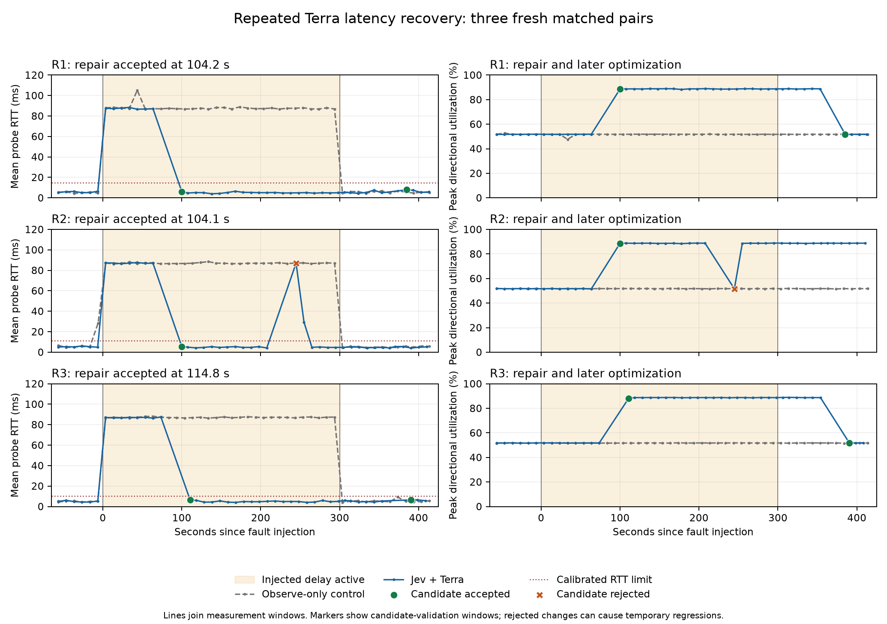

# Abilene experiment results and conclusions

Updated: 2026-11-27. Working evidence record for the final report and paper.

The experiments ask whether a guarded autonomous controller can repair faults
and improve performance, and whether Jev helps an LLM-based controller do so.
The strongest repeated result so far is successful bounded repair across the
fixed benchmark. Continuous experiments have demonstrated a feasible route
split, three successful Terra latency repairs in one fresh repeated campaign,
and two further successes in earlier source cohorts. Two fresh runs also
accepted utilization improvements after fault removal. Broader continuous
optimization and recovery across models remain open questions.

## How results are recorded

Update this document after each significant completed experiment or diagnostic.
For each entry retain the protocol, observation, supported conclusion,
limitations, and evidence location. Keep negative outcomes and measurement
failures. A prepared or running experiment has no result until reviewed.
Revise conclusions when new evidence changes them, while retaining earlier
observations and the reason for the revision.

Run names below identify preserved local artifacts. `runs/` and `captures/`
are ignored by Git; archive these artifacts separately for paper reproducibility.
This document retains the reviewed findings in the repository. Frozen source
hashes in each experiment identify the implementation actually tested.

Do not pool bounded repair, forced-action diagnostics, known reference actions,
and natural continuous decisions into one success rate. Keep different traffic,
measurement, model, provider, and controller versions separate.

## Bounded repair and Jev comparison

### Benchmark coverage and repeated campaign

The coverage campaign completed 60/60 trials: one run in each arm across 30
scenarios. The repeated campaign used Luna (`openai/gpt-6-luna`) and Jev
(`typesafe/jev-1.14`, resolved to `typesafe/jev-1.14-20261014`), with five paired
repetitions across the same 30 scenarios.

| Repeated campaign measure | LLM only | Jev plus LLM |
| --- | ---: | ---: |
| Accepted repairs | 150/150 | 150/150 |
| First-attempt successes | 141 | 146 |
| Median fault-to-acceptance time | 48.87 s | 50.54 s |
| LLM calls | 159 | 102 |
| Reported inference cost | $0.359317 | $0.363875 |

All 300 trials confirmed cleanup. Jev used 52 catalog shortcuts among 55
single-host cases; no wrong catalog choice or false no-change decision was
used. The single-host paired mean time difference favored Jev by 4.06 s.
Across all scenarios, the paired mean difference was −1.17 s, with an
exploratory hierarchical bootstrap 95% interval of −6.40 to +4.67 s.
These paired differences and the separate arm medians answer different
questions and should not be substituted for each other.

**Conclusion:** Jev reduced LLM calls on this benchmark while retaining repair
success. The overall timing interval includes zero, and aggregate reported
cost was slightly higher. This campaign does not establish an overall speed
or cost advantage. Catalog-covered single-host cases show a clearer timing
benefit. Results are conditional on this fixed benchmark, catalog and model.

Evidence: [coverage analysis](../runs/bounded-coverage-20261123/analysis.json)
and [300-trial analysis](../runs/bounded-repeated-20261123/analysis.json),
with paired and family CSVs in the same directories.

### Other model smoke comparisons

Each smoke campaign comprised six scenarios in two arms, with one repetition.

| Model | LLM only | Jev plus LLM | Failure location |
| --- | ---: | ---: | --- |
| `deepseek/deepseek-v4.1-flash-1017` | 6/6 | 5/6 | Jev arm, SEA–SVA congestion |
| `google/gemini-3.1-flash-lite` | 5/6 | 5/6 | Both arms, HOU–ATL OSPF area |

All 24 trials confirmed cleanup.

**Conclusion:** Both models repaired several bounded faults. These small
screening campaigns identify failures worth investigating; they do not support
a general model ranking or the claim that cheaper models cannot repair networks.
Do not combine their success rates with the different continuous latency task.

Evidence: [DeepSeek smoke summary](../runs/deepseek-flash-smoke-20261124/summary.json)
and [Gemini smoke summary](../runs/gemini-flash-lite-smoke-20261124/summary.json).

## Verification can reject a model-selected forbidden path

A diagnostic restricted Jev to a single available action producing an
SEA-to-NYC path through LAX. The same candidate passed without the path policy,
but Batfish rejected it when LAX was forbidden. The controller did not deploy
it; cleanup and restoration succeeded. All diagnostic checks passed.

**Conclusion:** This demonstrates enforcement of the supplied path policy
against a real Jev-selected candidate. It is a forced-choice safety test,
not evidence of natural Jev routing accuracy or complete policy coverage.

Evidence: [diagnostic result](../runs/jev-forbidden-path-20261123T145518Z-6f4760/diagnostic-result.json).

## Continuous measurement and optimization findings

### Probe concurrency affects measured performance

A diagnostic using NYC as the source reproduced the probe-concurrency effect
outside Seattle. Under 90 Mbps aggregate UDP load, 24 probe workers measured
21.36 ms mean RTT and three failed probes across 220 pair measurements.
Four workers measured 4.18 ms with no failed probes; one worker measured
2.76 ms with none. Router configurations were fixed. Forwarding-process CPU
was high under heavy traffic across these worker settings.

**Conclusion:** Measurement concurrency can perturb this software-router lab;
the effect is not confined to SEA. The observations are consistent with software
forwarding pressure, but do not isolate RAM, CPU scheduling, threading, or a
particular cEOS defect as the cause. Reducing probe concurrency mitigates the
effect, and does not guarantee clean measurements at every offered load.

Current continuous trials use four probe workers and six-second windows.
The later 70 Mbps shaping / 35+25 Mbps traffic protocol must remain separate
from earlier 100 Mbps shaping / 50+40 Mbps traffic results.

Evidence: [NYC source comparison](../runs/rtt-source-comparison-20261126T194619Z/analysis.json)
and [continuous protocol](PERSISTENT_CONTROLLER.md#run-live-on-abilene).

### Early optimization attempts and route split feasibility

A 20-minute Luna session at 70 Mbps capacity with 35+25 Mbps heavy demand
recorded three optimization rollbacks and no accepted optimization. One
candidate, SVA Ethernet2 cost 31, encountered a runtime collection error whose
exact cause was not retained at that time.

A separate diagnostic deployed that exact known candidate and passed three
runtime windows: peak directional utilization fell from 88.77% to
51.73–51.83%, with mean probe RTT of 4.61–4.85 ms.

**Conclusion:** A beneficial configuration exists under the tested load.
Reference-action feasibility does not demonstrate that the autonomous loop
reliably discovers and retains it. The original collection failure was not
reproduced, so its cause remains unresolved. Structured measurement-error
reporting was subsequently added.

Evidence: [20-minute analysis](../captures/continuous-9821aba5a265-analysis.json)
and [candidate diagnostic](../captures/sva-runtime-diagnosis-20261126T230415Z-analysis.json).

## Controlled continuous latency recovery

### Protocol and acceptance

The five-minute-fault comparisons use 70 Mbps shaping in each backbone
direction, constant SEA→SVA traffic at 35 Mbps and SEA→LAX at 25 Mbps, and an
initial known SVA Ethernet2 cost-31 route split accepted through verification
and runtime checks. Each arm lasts eight timed minutes: one minute before the
fault, five minutes with 200 ms directional DEN→KCY delay, and two minutes
after scheduled removal. A fresh observe-only arm precedes Jev+LLM.

The initial split is experimental setup. Timed-arm decisions are natural:
the known repair is not supplied to the models. Host reachability and OSPF
remain healthy in the reviewed five-minute pairs while delay raises aggregate
probe RTT to approximately 87–89 ms.

RTT acceptance uses the mean across all 110 directed host pairs, with limit
`healthy baseline × 1.25 + 5 ms`. It is not per-flow application latency.
The limit varies with calibration: 13.32 ms in the pinned Wafer trial, rather
than a universal fixed 13.3 ms. Receiver and utilization checks also apply.
Only acceptance before fault removal starts counts as autonomous recovery.

Earlier interface auditing found misleading per-flow labels for aggregate RTT,
incomplete rejection feedback, and unsupported handling of observation
requests. These were corrected before the five-minute model comparisons.
Earlier trials remain development evidence and should not be pooled with them.

Evidence: [interface audit](../captures/latency-recovery-decision-interface-audit.json)
and [protocol guide](PERSISTENT_CONTROLLER.md#controlled-sustained-latency-recovery).

### Reviewed model results

| Trial | Result while delay remained active | Supported conclusion |
| --- | --- | --- |
| Luna, five-minute fault | Requested observations; SVA cost-10 proposal reduced RTT only to 57.99 ms and was rolled back. A later observation request exceeded the one-round budget. | No accepted repair within the declared three-attempt, one-observation-round budget. |
| Terra, original trial | DEN Ethernet3 cost 100, KCY Ethernet1 cost 100, SVA Ethernet2 cost 10 accepted about 170.03 s after injection. RTT fell from 87.80 to 5.32 ms, with zero measured UDP loss. | First demonstrated autonomous repair while the fault remained active. |
| Terra, fresh replication | First proposal set DEN Ethernet3 and KCY Ethernet1 costs to 50 and SVA Ethernet2 to 10. Accepted at 94.06 s; RTT fell from 86.48 to 5.34 ms with zero measured UDP loss. | Second observed successful repair, with the same route-avoidance strategy and a different sufficient backbone cost. |
| DeepSeek Pro, default routing | SVA-only repair rolled back; two subsequent decision errors. Historical error details incomplete. | No accepted repair; reasoning and transport/completion errors cannot all be disentangled retrospectively. |
| DeepSeek Pro, pinned `wafer/us` | All four saved LLM completions returned normally. First SVA-only repair reduced RTT 88.91→57.76 ms and was rolled back. After receiving requested routing tables, it repeated that patch; policy blocked the repeat. | Eliminating provider variation did not produce a complete repair in this trial. |

Terra's repaired configuration remained healthy for 11 subsequent observation
windows while the delay was still active: mean probe RTT ranged from
4.34 to 8.82 ms, median 5.15 ms, with zero measured UDP loss. Peak utilization
increased from approximately 52% to 89% during repair; restoring latency and
balancing utilization are distinct objectives.

Terra later deployed an optimization before scheduled fault removal, but its
acceptance measurement occurred after removal. Record that separately: it is
not clean evidence of optimization under the same active fault.

The unpinned DeepSeek billing screenshot showed Wafer for the first two calls
and DigitalOcean for the third. The last response used exactly 4,096 output
tokens, suggesting truncation; its finish reason was not retained. This does
not explain the separate 522-token failure. Approximate screenshot-based cost,
including Jev, was $0.0713; the original $0.0104 was only a known subtotal.

Pinned Wafer recorded total inference cost of $0.021716514, including a fourth
LLM decision made after scheduled fault removal and discarded when its
opportunity became invalid. That call is not a fourth repair attempt during
the fault. One telemetry timeout occurred late in the post-removal period.
All reviewed five-minute pairs confirmed configuration restoration, preserved
shaping, cleared faults, and successful traffic cleanup.

Evidence:

- [Luna analysis](../captures/latency-recovery-5m-pair-20261127T010900Z-analysis.json).
- [Terra analysis](../captures/latency-recovery-terra-5m-pair-20261127T013308Z-analysis.json).
- [Terra replication analysis](../captures/latency-recovery-terra-replication-5m-pair-20261127T121653Z-analysis.json).
- [DeepSeek default-routing analysis](../captures/latency-recovery-deepseek-pro-5m-pair-20261127T015808Z-analysis.json)
  and [external billing supplement](../captures/latency-recovery-deepseek-pro-5m-pair-20261127T015808Z-billing-supplement.json).
- [DeepSeek pinned-Wafer analysis](../captures/latency-recovery-deepseek-wafer-5m-pair-20261127T112556Z-analysis.json).

### Hypothesis about incomplete repairs

**Working hypothesis, not an established explanation of model reasoning:**
several models identify a plausible local improvement but struggle to connect
it to the network-wide acceptance objective. Lowering SVA's cost moves the UDP
workload away from the delayed route, while other host-pair paths still cross
DEN→KCY. Residual probe RTT remains around 58 ms. Raising costs on the impaired
backbone connection can redirect a broader set of paths, as Terra's accepted
candidate demonstrated.

Possible contributors are directional OSPF costs and return paths, performance
degradation without failed adjacencies, the volume of configuration/routing
evidence, and failure to revise a diagnosis after rejection. DeepSeek's repeated
patch after receiving routing tables is consistent with this hypothesis, but
does not identify which contributor caused the failure. OSPF's configured
costs do not automatically track the injected latency.

Terra repaired the fault in the two earlier trials and all three fresh
repetitions reviewed below. The evidence
presentation comparison below held model, provider, traffic, output budget,
and retry limits fixed, adding a derived path summary without revealing a
repair. It did not improve the repair outcome. This weakens the narrower claim
that this particular summary is sufficient to resolve the failure; it does
not isolate a general reasoning limitation or rule out other presentations.

### Evidence presentation comparison

Preparation: `runs/latency-recovery-deepseek-evidence-20261127T124812Z`.
Status: completed and reviewed. Four stages ran in this order: original
evidence control, original evidence Jev+DeepSeek, augmented evidence control,
augmented evidence Jev+DeepSeek. Each stage uses the same eight-minute protocol.
DeepSeek Pro was pinned to `wafer/us` with a 4,096-token output budget. All
physical protocol and model request checks matched across conditions, and
each autonomous stage matched its own fresh control.

The intervention appends a deterministic table of explicit directional costs
and the 12 largest measured pair RTTs with forward/return shortest-path
estimates. Up to four equal-cost alternatives per direction are retained.
Full original evidence remains, Jev sees the original evidence in both
conditions, and no fault label or recommended repair is added. Invalid or
unsupported evidence produces an unavailable summary. Summary availability
must be checked when interpreting the comparison.

The primary endpoint is accepted repair before fault removal. Secondary
endpoints include the proposed changes, repeated rejected patches, observation
requests, inference and total recovery time, input/output tokens, reported cost,
and safety/cleanup outcomes. This is a test of structured augmentation, not
prompt shortening or extra live sensing. One trial per condition and fixed
order make it exploratory; a promising result needs repeated, counterbalanced
runs. A failure does not establish that clearer evidence can never help.

| Measure | Original evidence | Original plus path summary |
| --- | ---: | ---: |
| Accepted repairs during fault | 0 | 0 |
| First proposal | SVA Ethernet2 cost 10 | SVA Ethernet2 cost 10 |
| RTT after first candidate | 57.53 ms | 57.75 ms |
| Calibrated RTT acceptance limit | 11.17 ms | 12.19 ms |
| LLM calls dispatched during fault | 3 | 3 |
| Input tokens for those calls | 84,018 | 97,434 |
| Cumulative LLM time for those calls | 12.54 s | 16.95 s |
| Reported inference cost during fault, including Jev | $0.015409 | $0.018550 |

Both first candidates failed runtime latency acceptance and were rolled back.
The original-evidence condition repeated the rejected SVA-only patch twice;
the stability policy blocked both repeats. One of those candidate responses
also contained observation request identifiers, but its outcome was candidate,
so it did not queue a separate observation collection.

The augmented condition received an available summary for all three calls
during the fault. Each summary covered 110 measured pairs and displayed 12
high-RTT pairs, all of which had at least one estimated forward/return path
traversing DEN Ethernet3. The second response completed normally at Wafer but
failed JSON parsing (`ValidationError`, `json_invalid`), with 398 output tokens;
there was no output-limit indication. The third response requested telemetry
and routing tables, but the three-attempt budget prevented another collection
and inference cycle. No complete alternative repair reached deployment.

The two passive controls had almost identical during-fault median probe RTTs,
86.86 and 86.87 ms, with healthy host reachability and OSPF. All four stages
completed and confirmed configuration restoration, unchanged shaping, cleared
faults and traffic cleanup. Each autonomous stage recorded one late telemetry
timeout after fault removal.

Each autonomous arm also made a fourth dispatch after scheduled fault removal.
Both decisions were discarded before action; saved usage is available for both.
Including those calls, total reported inference charges were $0.019760934 for
original evidence and $0.022885488 for augmented evidence. The fourth summary
was unavailable because healthy reachability/adjacency evidence was not present
at that transition; it is separate from the three available summaries during
the fault.

**Conclusion:** This structured augmentation did not demonstrate a repair
benefit under the fixed budget. It increased input tokens and recorded
inference time/cost, and did not change the first incomplete proposal. The
failure cannot be attributed simply to a missing summary or provider switch.
The result remains consistent with difficulty applying network-wide evidence,
but malformed JSON and the attempt limit also contributed to the augmented
condition's failure. One fixed-order comparison cannot identify a general
cause or prove that clearer or shorter evidence would never help.

Evidence: [four-stage analysis](../captures/latency-recovery-deepseek-evidence-20261127T124812Z-analysis.json).

### Terra replication and unsafe optimization

The fresh replication completed successfully using the original Terra model,
default provider routing and 4,096-token budget, with current diagnostic
instrumentation. All paired source, workload, capacity, initial configuration,
timing and request-setting checks matched. The control remained impaired at a
median 87.01 ms during the fault. Jev permitted performance evaluation at
27.32 s; Terra's first proposal arrived at 57.41 s and repair was accepted at
94.06 s, before scheduled removal at 300 s. The LLM call itself took 23.03 s.
Returned provider metadata identified OpenAI. No known repair was supplied.

Seventeen full observation windows with the accepted repair configuration,
after acceptance and before fault removal, measured mean probe RTT of
4.16–6.69 ms, median 5.56 ms, with healthy reachability and OSPF and no recorded
measurement errors. These windows exclude the temporary optimization candidate.

At 201.54 s, Terra proposed DEN Ethernet3 cost 1, DEN Ethernet2 cost 20 and
SEA Ethernet1 cost 22. Peak utilization improved from 88.64% to 51.83%, but
mean probe RTT worsened from 5.70 to 77.47 ms. Runtime acceptance rejected the
candidate at 238.76 s and confirmed rollback to the accepted repair at 241.07 s,
while the injected delay was still active. This proposal was measured after
deployment: the guardrail limited persistence of the regression, rather than
preventing every temporary performance regression.

**Conclusion:** Successful autonomous latency repair was reproduced, using
cost 50 rather than 100 on the backbone connection. Two successes support
repeatability in this controlled setup, not a general reliability estimate.
Terra can still propose an optimization that trades away restored latency.
The rejection and confirmed rollback demonstrate the value of checking all
performance constraints together, rather than accepting utilization improvement
alone. Continuous optimization success remains unestablished by this run.

Both arms confirmed configuration restoration, preserved shaping, fault
removal and traffic cleanup. One telemetry timeout occurred late after fault
removal. Three completed decision artifacts report $0.10089992 in inference
charges; a fourth dispatched decision was discarded without a saved usage
artifact, so full-session cost remains unknown. Retain the known subtotal and
unknown billing separately.

Evidence: [replication analysis](../captures/latency-recovery-terra-replication-5m-pair-20261127T121653Z-analysis.json)
and preparation `runs/latency-recovery-terra-replication-5m-pair-20261127T121653Z`.

## Repeated Terra campaign

The completed campaign `runs/latency-recovery-terra-repeated-20261127T143829Z`
used three fresh observe-only/Jev+Terra pairs under one frozen source snapshot.
All six stages matched the manifest, initial configuration, shaping, workload,
timing and model-request settings. The model was `openai/gpt-6.1-terra`, with
default provider routing, original evidence and a 4,096-token output budget;
all saved LLM responses identified OpenAI. These three trials form their own
cohort. The earlier two Terra successes remain separate source cohorts.

| Repetition | Repair accepted after injection | RTT before → after repair | Later optimization outcome |
| --- | ---: | ---: | --- |
| 1 | 104.23 s | 86.59 → 5.88 ms | Accepted after fault removal |
| 2 | 104.12 s | 87.22 → 5.58 ms | Active-fault regression rolled back; final candidate rejected on predeployment timeout |
| 3 | 114.78 s | 86.88 → 6.29 ms | Accepted after fault removal |

All three repairs succeeded on the first proposal, before the delay was
removed at 300 s. Each lowered SVA Ethernet2 cost to 10 and raised both ends
of the DEN–KCY connection: cost 50 in repetitions 1–2, cost 100 in repetition 3.
The median fault-to-accepted-repair time was 104.23 s, range 104.12–114.78 s.
The three controls remained impaired, with during-fault median mean RTTs of
87.38, 86.97 and 87.18 ms and no failed host/OSPF windows.

After repair and before fault removal, 19, 16 and 18 periodic windows matched
the accepted repair configuration in repetitions 1–3. Their median mean probe
RTTs were 5.04, 4.75 and 4.78 ms. Repetition 2's first observation after the
optimization rollback measured 29.37 ms; the next measured 4.76 ms. The temporal
association does not establish the transient's cause. Repetition 1's largest
observed per-flow loss fraction in these windows was 0.00089824 (about 0.09%);
the initial repair acceptance windows had zero measured UDP loss in all runs.
These exceptions remain in the analysis and figure.

During the active fault, repetitions 1 and 3 proposed undoing the repair; the
stability policy blocked both as recent reversals. Repetition 2 deployed a
similar proposal. Utilization fell from 88.85% to 51.64%, but RTT rose from
5.72 to 87.06 ms, so runtime checks rejected it and confirmed rollback at
251.27 s. This is evidence of a temporary regression followed by restoration,
not proof that guarded execution prevents all performance disruption.

After fault removal, repetition 1 accepted SVA Ethernet2 cost 71 at 389.31 s:
peak utilization fell from 88.67% to 51.78%, with validation RTT 7.87 ms.
Repetition 3 accepted DEN Ethernet3 cost 1 plus SVA Ethernet2 cost 22 at
394.94 s: utilization fell from 88.77% to 51.72%, with RTT 6.48 ms.
Both before/after validation windows were entirely after removal, so these
are cleaner post-removal optimization observations than the original trial's
measurement crossing the fault transition. Three and two further periodic
windows, respectively, confirmed healthy reachability and OSPF with zero
measured receiver loss. That is short follow-up, not long-term stability.

Repetition 2's final post-removal candidate reached verification near the
session deadline, then was rejected with `predeploy_TimeoutError`. It was not
measured as a successful or harmful deployed optimization. Each active run
also recorded a late telemetry timeout near session end.

**Conclusion:** All three fresh trials reproduced autonomous repair of this
specific impairment, with similar repair strategy and timing. Three observed
successes do not establish production reliability or generalize to other
faults. Two runs additionally demonstrated accepted utilization improvements
after the physical impairment was removed. The third and the active-fault
proposals show why continued optimization requires independent performance
checks, stability policy and rollback. This campaign uses passive controls;
it does not isolate Jev's contribution against an LLM-only controller. All
successful repairs involved LLM synthesis, rather than a Jev catalog shortcut.

All six stages completed and confirmed restoration, unchanged shaping, fault
removal and traffic cleanup. All 12 dispatched decisions have saved usage:
6 Jev calls and 12 LLM calls, with total reported inference charges of
**$0.4171398** across the three active runs.



The shaded interval is the injected delay. Lines join measured windows; circles
and crosses mark accepted and rejected candidate-validation windows. These
samples do not provide continuous packet-level coverage. The rejected candidate
in repetition 2 and the subsequent transient are both visible.

Evidence: [reviewed analysis](../captures/latency-recovery-terra-repeated-20261127T143829Z-analysis.json),
[vector figure](figures/terra-repeated-20261127.svg),
[plotted samples](figures/terra-repeated-20261127.csv).
Reproduce the figure with an interpreter that has matplotlib:

```bash
python3 scripts/plot-continuous-latency.py \
  captures/latency-recovery-terra-repeated-20261127T143829Z-analysis.json \
  --output-prefix docs/figures/terra-repeated-20261127
```

## Evidence still needed for the final report

Related-work review: [NetConfArena comparison and proposed Jev experiment](NETCONF_ARENA_COMPARISON.md).
NetConfArena already evaluates closed-loop multi-device LLM configuration;
our distinction is the Jev comparison and guarded persistent performance
management. Direct reproduction requires its own emulator/interface/evaluator.
No external-benchmark result is claimed.
The NetConfArena experiment is deferred; its scaffold remains on a separate
branch while the Abilene study and report are completed.

1. Add a matched continuous Terra LLM-only baseline. The fresh three-pair
   campaign establishes repair capability against passive controls, not whether
   Jev improves that capability. Use the same source, traffic, catalog exposure,
   fault schedule, inference budget and acceptance checks in both active arms.
2. Keep three inference paths separate in tables and plots: LLM only, Jev
   catalog decisions without LLM, and Jev escalation to LLM. Report inference
   latency separately from verification, convergence, measurement and total
   fault-to-acceptance time. Do not assume model speedups translate directly
   into equal end-to-end speedups.
3. Report bounded outcomes by scenario family and paired repetition. Keep
   model smoke comparisons exploratory until repeated under matched conditions.
4. Establish repeated natural continuous optimization with matched passive
   controls, retained improvements, and later recovery from changing conditions.
   Separate latency restoration from utilization improvement, including tradeoffs.
5. The first structured-augmentation comparison found no repair benefit. If
   pursuing evidence presentation further, distinguish actual prompt reduction
   from augmentation and repeat under counterbalanced conditions. Preserve
   rejection reasons, observations, usage, and discarded calls in accounting.
6. Treat Jev-only and an LLM-updated catalog as future separate studies. Neither
   has been established by the two-arm campaigns; forced-choice diagnostics do
   not answer whether Jev can operate independently.

## Prepared continuous active arm comparison

Preparation: `runs/latency-recovery-terra-active-comparison-20261127T170703Z`.
Status: eleven original timed stages completed; AC-powered replacement of the
final matched block is prepared below after repeated setup failures. This is a new matched cohort;
earlier Jev+Terra successes are context, not substitutes for paired trials.

Four blocks each contain a fresh passive control and both active arms.
Terra-only runs before Jev+Terra in blocks 1 and 3, and after it in blocks 2
and 4. The 12 stages total 96 timed minutes before setup and cleanup. Every
active arm matches its block's control, and later controls match the first
control's initial configuration, capacity and physical protocol.

The source snapshot is identical to the completed three-repetition campaign.
Both active arms use `openai/gpt-6.1-terra`, original evidence, the same public
catalog, 4,096-token budget, inference/retry/observation limits, stability
policy, Batfish checks and runtime acceptance. The workload and five-minute
DEN→KCY delay protocol remain fixed. The Jev arm adds natural screening with
`typesafe/jev-1.14`; no route or escalation is forced. Default OpenRouter
routing is retained, so actual providers and cloud timing must be reported.
An offline check confirms that under escalation both arms supply the same
system prompt and public state to the LLM.

The primary endpoint is repair accepted before scheduled fault removal,
reported per paired repetition. Report failures rather than selecting only
successful timings. Separate Jev calls, LLM calls and inference time from
end-to-end acceptance time, and keep active-fault versus post-removal
optimization outcomes distinct. This fault lies outside the current host-enable
catalog's direct coverage; Jev overhead or escalation without improvement is
a valid result. No speed or cost advantage is assumed.

The launcher preserves negative repair outcomes, stops on execution failure or
unconfirmed cleanup, and rejects cancelled, blocked or incorrectly labeled
stages. Explicit resume skips only a completed prefix of confirmed-clean stages;
incomplete outputs require inspection and are never overwritten.

### Setup interruption and preserved continuation

The original `r3-llm` stopped before timed monitoring, fault injection or model
inference. Both baseline and candidate passed Batfish. The known setup split
reduced utilization from 88.64% to 51.77%, with full reachability, healthy
OSPF and zero measured UDP loss, but its validation RTT was 17.73 ms against
a 10.17 ms limit derived from a 4.14 ms healthy baseline. Runtime acceptance
rejected the split and confirmed rollback. Several pairs ending at SEA had
RTTs above 100 ms in that window; the cause is not established.

The harness confirmed restoration, preserved shaping and absence of its fault.
A subsequent read-only check found the checkpoint configurations restored,
all 28 backbone directions at 70 Mbps, all 110 pairs reachable, no OSPF
mismatches and idle mean RTT 4.87 ms. Idle measurements do not establish the
cause of the earlier loaded-window excursion.

This is a setup/infrastructure rejection, not a Terra repair failure. Retain it
in execution accounting. The two earlier active-arm pairs and three passive
controls are preserved; the final paired comparison remains incomplete.

Continuation: `runs/latency-recovery-terra-active-continuation-20261127T184503Z`.
It retains the seven completed stage paths and gives `r3-llm` a new retry output
directory, then continues `r3-jev`, `r4-observe`, `r4-jev`, and `r4-llm` in the
predeclared order. The failed setup directory and original preparation are
unchanged. Source hashes, thresholds and all physical/model settings remain
fixed. This one setup-only retry is a reported protocol deviation; no model
outcome is being selected for replacement. The new setup must pass the same
guards before any timed model trial starts.

Evidence: [setup stop and read-only lab check](../captures/latency-recovery-terra-active-comparison-20261127T170703Z-setup-stop.json).

### Final stage unhealthy baseline

The first continuation completed the replacement `r3-llm`, then `r3-jev`,
`r4-observe` and `r4-jev`. The final original `r4-llm` stopped before deploying
the known setup split: its original reference had failed host reachability,
mean RTT 65.90 ms and receiver loss fractions 0.18793 and 0.18504. A second
unchanged-configuration window remained unhealthy at 63.58 ms. OSPF passed.
The executor returned `incomparable_baseline`; healthy-reference requirements
were not satisfied. No timed fault or model inference occurred in this stage.

The harness confirmed restoration, shaping preservation and a cleared fault.
A subsequent configuration-fixed diagnostic used the same 35/25 Mbps demand,
with no injected fault or configuration change. Idle RTT was 6.96 ms, with all
110 pairs reachable and no OSPF mismatches. Three loaded windows measured
16.37, 11.74 and 18.86 ms, with healthy host/OSPF checks. Two windows had full
delivery; the third had about 0.23% loss per flow. SEA and SVA container CPU
samples were about 90% and 87% under load. These observations do not isolate
the cause, but show that the lab's loaded measurements are noisier than many
earlier campaign baselines. Diagnostic traffic was stopped and configurations
remained unchanged; no healthy calibration or acceptance threshold was relaxed.

Final continuation: `runs/latency-recovery-terra-active-final-20261127T203644Z`.
It preserves all eleven completed stages, the original failed `r3-llm` setup,
and this failed `r4-llm` setup. Only `r4-llm` receives a fresh output directory.
It must pass the original setup guards and match the existing block-four
control before timed execution. Report both setup-only retries and the noisy
readiness measurements as protocol/environment limitations. The four-pair
active comparison is still incomplete until that timed stage is reviewed.

Evidence: [final setup stop and fixed-load diagnostic](../captures/latency-recovery-terra-active-comparison-20261127T170703Z-final-setup-stop.json).

### Repeated final setup failure and power state investigation

The `r4-llm` setup retry also failed before any timed trial or model call.
Baseline RTT was 23.32 ms; candidate RTT reached 108.99 ms against a 34.14 ms
limit, and receiver loss rose to 8.36% and 8.76%. OSPF and host reachability
passed. The known split reduced utilization to 49.28%, but failed RTT and
receiver-preservation checks. Rollback, restoration, shaping preservation and
fault cleanup were confirmed. This is the third preserved setup failure in
the campaign, including the earlier `r3-llm` failure, not a third failed model
repair. Eleven timed stages remain complete and the last model comparison is
still missing.

An audit of the inspected SEA/SVA/DEN/LAX container cgroups found no configured
CPU cap, CPU-throttling events, memory limit or OOM events. Current host memory
pressure was zero. These snapshots do not establish historical resource
conditions throughout the campaign.

A fixed-configuration, fixed-demand diagnostic measured three windows with
live visualizer sampling on, three with its process paused, then three after
resuming it. RTT remained elevated during the paused phase. The visualizer
was resumed, diagnostic traffic stopped and configurations remained unchanged.
This small sequential test did not establish visualizer sampling as the cause;
later windows also showed loss, so time/load effects remain possible.

The host power audit then found AC offline, battery discharging,
`amd-pstate-epp` energy preference `power`, and a reported CPU maximum scaling
frequency of 2,000,000 kHz. Battery/power policy is a plausible explanation for
reduced forwarding capacity, but prior power states were not recorded, and a
matched powered-versus-battery test has not established causation. Record this
as an environmental limitation, not a diagnosed cEOS defect or proven RAM
shortage. No power policy was modified during these checks.

Further timed retries are deferred pending AC power and a new fixed-load
readiness check. Do not relax acceptance limits or repeatedly select a clean
window to complete the planned dataset. Any restoration of host power settings
and subsequent continuation must be reported alongside the original failures.

Evidence: [retry stop and diagnostic bundle](../captures/latency-recovery-terra-active-comparison-20261127T170703Z-retry-stop-diagnostics.json).

### AC power readiness and replacement matched block

After the user connected AC power, the host reported mains online,
`performance` governor/energy preference, and maximum scaling frequency
5,157,895 kHz rather than 2,000,000 kHz. With the same original configurations,
35/25 Mbps workload, 70 Mbps shaping and collector, three loaded diagnostic
windows measured 4.82, 4.79 and 4.53 ms mean probe RTT, with zero measured UDP
loss and healthy host reachability/OSPF. Idle mean RTT was 4.62 ms. Diagnostic
traffic stopped and configurations remained unchanged.

The before/after evidence strongly supports host power policy as a contributor
to the instability. It is not a randomized battery-versus-AC study, and prior
power states were not logged throughout the earlier blocks. Do not present
those blocks as uniformly power-controlled or infer that every earlier
regression was caused by battery use.

New effective preparation:
`runs/latency-recovery-terra-active-ac-block-20261127T210406Z/plan.json`.
Resolve output paths through this manifest: it retains the completed first
three blocks, including the successful `r3-llm` retry, and assigns fresh output
directories to **all three** block-four stages, in the original order
`r4-observe`, `r4-jev`, `r4-llm`. The earlier block-four control and successful
Jev trial remain archived as additional observations. Both failed final setup
attempts and the earlier failed `r3-llm` setup remain preserved.

Repeating the whole final block avoids comparing a newly AC-powered LLM trial
only with an earlier Jev trial whose power state was not recorded. This is an
explicit environment-qualified replacement, not silent removal of a model
outcome. Report it separately in sensitivity analyses, retain earlier unpaired
observations and their charges, and distinguish analysis-cohort charges from
total experiment expenditure. Source hashes, traffic, model settings and
acceptance guardrails are unchanged.

The replacement launcher requires the recorded AC/performance policy before
each new stage and samples AC/CPU0 policy once per second during execution.
Observed changes or unavailable power evidence stop advancement after the
current stage, whose output is retained for inspection. The sampling does not
guarantee detection of sub-second changes or characterize all thermal effects.
The three new stages total 24 timed minutes plus setup/cleanup. No replacement
model results are available at preparation.

Evidence: [AC readiness diagnostic](../captures/latency-recovery-terra-active-comparison-20261127T170703Z-ac-readiness.json).

### Completed Terra-only versus Jev+Terra comparison

All twelve stages in the effective AC-block manifest completed. Each stage
reported configurations restored, fault cleared and traffic cleanup successful.
The final three stages recorded the required AC/performance state before and
after execution, with no power-state change events recorded by the sampler.
Earlier blocks still have unrecorded power state.

| Matched block | Terra-only accepted repair (s) | Jev+Terra accepted repair (s) |
| --- | ---: | ---: |
| 1 | 95.446 | 104.573 |
| 2 | 105.277 | 180.979 |
| 3 | 85.728 | 104.584 |
| 4, recorded AC/performance | 160.394 | 179.241 |

Both active arms accepted an autonomous repair before scheduled fault removal
in 4/4 trials. Terra-only was faster in all four matched blocks. Median
fault-to-acceptance time was 100.361 s for Terra-only and 141.913 s for
Jev+Terra; the mean within-block Jev-minus-Terra difference was +30.633 s.
These are descriptive results from four pairs, not a definitive population
effect or evidence that Jev's own inference accounts for the entire gap.

The first saved decision in each Jev-arm trial escalated to Terra. Jev's
recorded inference time for those decisions was approximately 0.40–0.53 s;
in blocks two and four Terra then requested additional observations before
proposing the repair. Thus this tests the addition of Jev screening and
fallback on a fault outside the current host-repair catalog. It does **not**
test Jev-only, nor compare a catalog shortcut against LLM reasoning.

All four passive controls retained high fault-period median mean probe RTT
(87.36–87.92 ms). Active-arm fault-period medians include the delay before
repair: the Jev medians in blocks two and four remain about 87 ms despite
successful later repair. They must not be described as post-repair RTT.
Accepted repair, sustained recovery, and later optimization remain separate
endpoints. Detailed per-call billing and phase-specific optimization analysis
are not established by this summary.

Conclusion: adding the current Jev catalog did not improve repair success or
end-to-end repair time in this small latency-fault comparison. A Jev-only
study requires a separate arm and a declared catalog; expanding that catalog
would constitute another experimental condition. Preserve the setup failures,
earlier superseded block-four observations and power-state deviation when
reporting these results.

### Follow-on direction: verified action memory

The planned latency comparison is complete. Detailed per-call accounting and
phase-specific optimization analysis remain report work, not unfinished timed
trials. Continuous-mode implementation and the report were checkpointed on
`feature/continuous-optimization` at `fe41e37` before creating
`feature/learned-jev-catalog`.

The new experiment asks whether successful LLM reasoning can be reused through
Jev's action catalog. The implementation quarantines typed LLM patches, requires
two matching accepted outcomes in distinct output directories for promotion,
scopes retrieval to configuration/demand/symptom context, and preserves all
existing deployment guards. Reused executor failures retire entries. Collection,
adaptive reuse and frozen evaluation modes are separate. No live result or
learning benefit is claimed yet. See [protocol and commands](THINKING_CACHE.md).

For initial training, use one fault per 20-minute run: two minutes of baseline,
a five-minute bounded repair opportunity, then post-repair stability and cleanup.
At least two matching independent successful LLM trials are needed; two distinct
valid patches do not promote each other. Use frozen catalogs for held-out
evaluation and retain fixed-catalog baselines, training costs, failed selections
and rollback outcomes. Session duration must be matched within a new study;
20-minute sessions are not directly interchangeable with the earlier eight-minute
latency trials.

First automated training pilot prepared at
`runs/thinking-cache-training-20261127T224720Z/plan.json`: two 20-minute Jev+Terra
collection trials, fresh shared cache, automatic two-minute baseline and
five-minute latency fault, unchanged 35/25 Mbps traffic and 70 Mbps shaping.
Cache collection is restricted to completed acceptance while the fault remains
active; scheduled removal cannot supply promotion evidence. Source/model/power
checks and cleanup gates are enforced by the launcher. This is a prepared
training pilot, not a completed result or a comparative evaluation.

### First live action-memory training pilot: two repairs, no promotion

The prepared pilot `runs/thinking-cache-training-20261127T224720Z` completed
both 20-minute trials. All reported configuration restoration, unchanged shaping,
fault removal and traffic cleanup. Recorded AC/performance policy remained
unchanged; no power-change events were present. Both used collection mode with
no eligible learned actions, so neither trial tested a Jev cache hit.

| Trial | Fault to accepted repair (s) | Runtime before → after mean probe RTT (ms) | Peak utilization before → after |
| --- | ---: | ---: | ---: |
| train-01 | 84.624 | 88.367 → 7.776 | 51.92% → 88.69% |
| train-02 | 86.202 | 87.643 → 6.365 | 51.73% → 88.60% |

Both first decisions escalated through Jev to Terra. Terra independently proposed
exactly the same three cost settings: Denver Ethernet3 = 50, Kansas City
Ethernet1 = 50, Sunnyvale Ethernet2 = 10. Both passed runtime acceptance while the
200 ms directed fault remained injected; both receiver flows had zero measured
loss in their accepted runtime windows. Recovery traded greater peak utilization
for latency restoration; it was not a simultaneous utilization improvement.

Despite the identical patch, `memory.sqlite` contains two quarantined entries
with one independent success apiece, rather than one active entry with two
successes. Direct comparison of the stored contexts found **only `slow_pairs`
differed**. Train-01 additionally classified Denver→Seattle and Seattle→Sunnyvale
as slow. All other stored guard fields, including configuration, demand,
capacity, topology, policy, health flags and intervention kind, matched.

This exposes brittleness in the initial exact slow-pair-set matching rule.
Its pair threshold derives from each trial's aggregate healthy RTT baseline
(acceptance limits approximately 14.36 and 16.82 ms), so measured pair variation
and baseline thresholds can fragment otherwise identical training cases.
This is an action-memory matching limitation, not differing LLM repair choices
or a failure of Batfish/runtime acceptance. Neither entry was manually merged,
promoted or modified during analysis. Preserve both snapshots and original
entries when revising the matching protocol; changed rules need versioning and
fresh prospective training/evaluation.

Post-acceptance periodic windows on the repair configuration while the fault was
still active numbered 17 and 22; median mean RTT was 6.436 and 5.828 ms.
Ranges were 5.184–53.874 ms and 4.743–6.804 ms, respectively, with no periodic
host/OSPF failures. Retain the elevated train-01 window; do not claim uniformly
low post-repair latency. Train-01 also tried an optimization that reduced peak
utilization to 51.72% but produced 91.679 ms runtime RTT; it was rejected and
rolled back. Both trials subsequently accepted an optimization **after scheduled
fault removal**, reducing peak utilization to about 51.73% at 7.851 and 6.136 ms
runtime RTT. Those are post-removal outcomes, not optimizations under active
fault, and did not create training entries.

There were four saved decisions matching four dispatches in each trial, eight
LLM calls and four Jev calls in total, no discarded inferences or cache errors.
Recorded total charges were $0.168790220 and $0.124282762, totaling $0.293072982;
these include later optimization/observation calls, not just the initial repairs.
The two collection updates occurred during active fault windows. Later accepted
post-removal optimizations did not seed entries, confirming the experiment's
collection gate in these runs.

Conclusion: typed action collection and verification worked live, and the LLM
repeated its repair successfully. Catalog promotion and LLM avoidance remain
unproven because the initial matching definition split the examples. Next revise
symptom matching to tolerate incidental threshold crossings while retaining
configuration/demand/policy scope and all deployment checks, then run fresh
training followed by frozen evaluation. Do not relax the two-independent-success
requirement simply to obtain a cache hit.

### Matching version 2: prospective correction and readiness audit

The action-memory context/protocol version is now 2. Configuration, topology,
inventory, objective, policy, demand, capacity, health-failure identities,
performance alarm, intervention kind and metric scope remain exact. Only the
slow directed-pair set is approximate: Jaccard overlap must be at least 90%
against every accepted context associated with an entry. Different patches
never share success counts; the two-independent-trial rule and executor guards
remain unchanged. All accepted contexts are retained, preventing a chain of
pairwise similar observations from gradually broadening an entry.

An offline diagnostic applied this definition to copies of the two archived
version-1 contexts: the patches were identical, overlap was 46/48 = 95.833%, and
the v2 definitions matched. This is a retrospective diagnostic, not promotion or
a new live result. Both original entries remain quarantined. The threshold is a
heuristic chosen after the pilot failure; fresh training and held-out evaluation
are required to assess it.

New preparation: `runs/thinking-cache-training-v2-20261127T234421Z/plan.json`.
It uses a new empty cache and unchanged two-by-20-minute training protocol.
Old evidence is not imported. The plan records the prior database/snapshot
hashes for provenance. Tests cover threshold crossings, dissimilar symptoms,
different patches, independent-trial counting, context drift, version isolation,
frozen snapshots, deployment handoff, and cache failures. The complete suite
passed 535 tests with six skipped. The prepared launcher passed offline execution,
source-pin, timing, resume and unconfirmed-cleanup checks; no model calls were made.

A separate live readiness check uses the explicitly labelled reference-validation
arm, not inference or catalog training:
`runs/thinking-cache-v2-readiness-20261127T234421Z`. Its results and cleanup must
be confirmed before starting the new training campaign.

The nonbillable live reference-readiness check completed successfully. The
initial split passed Batfish/runtime acceptance; injected delay produced
88.023 ms mean probe RTT versus the 5.689 ms accepted-split reference. The
explicit reference action passed three recovery windows, with last mean RTT
4.774 ms. Cleanup confirmed configuration restoration, unchanged shaping and
fault removal. All 22 Abilene containers and Batfish were running. Final AC/
performance policy matched the prepared requirements. These validate the test
apparatus and known solution, not natural model choices or a v2 cache hit.

Audit evidence is saved at
`runs/thinking-cache-training-v2-20261127T234421Z/readiness-audit.json`.
The new cache and trial outputs were confirmed absent, source and launcher pins
matched, and no LLM/Jev calls were made during the audit. Fresh training is ready;
no live version-2 learning outcome is available yet.

### Version 2 live training results

Both trials in `runs/thinking-cache-training-v2-20261127T234421Z` completed.
Both accepted a repair during the five-minute Denver→Kansas City delay and
confirmed fault removal, configuration restoration, shaping and traffic cleanup.
The power log recorded the expected AC/performance state throughout sampling.

| Training trial | DEN Ethernet3 / KCY Ethernet1 cost | SVA Ethernet2 cost | Fault to acceptance | Mean probe RTT before → after repair | Peak utilization before → after |
| --- | ---: | ---: | ---: | ---: | ---: |
| 01 | 100 / 100 | 10 | 162.67 s | 87.83 → 5.55 ms | 51.51% → 88.57% |
| 02 | 41 / 41 | 10 | 94.10 s | 86.98 → 5.41 ms | 51.83% → 88.81% |

Both accepted measurement windows recorded zero loss on both UDP flows.
Both trials permitted repair evaluation about 27.3 s after injection. In the
first, Terra requested routing tables and refreshed telemetry before proposing
a patch. In the second it proposed a patch on the first call.

Both cache entries had the same binding, identical structural guards and
exactly the same 46 slow directed pairs (46/46 overlap). Only the typed patch
differed. Each entry had one independent success and remained in quarantine.
The first snapshot contained one entry and the final snapshot contained two.
Collection mode exposed zero learned actions to the models. The matching
tolerance introduced in v2 was unnecessary for this particular pair.

An offline comparison used the two accepted intervention snapshots, identified
through their SQLite validation records. We extracted the configured directed
OSPF costs on all 14 backbone links, computed shortest distances, and compared
all equal-cost next-hop choices for each ordered pair of distinct routers.
All **110/110** sets matched. Costs 41 and 100 implemented the same modeled
forwarding choices in this topology. Other costs or link states could change
that result. The RTT and UDP measurements above establish the live effect of
each individual patch under the tested fault.

After acceptance and before fault removal, periodic windows on the repair
configuration had median mean RTT of 5.26 ms (14 windows) and 5.31 ms (17).
Train-02 had a high window of 54.43 ms. Its attempted optimization during the
fault lowered peak utilization to 51.70% but raised RTT to 87.29 ms and was
rolled back. After removal it accepted an optimization at 51.69% and 5.56 ms.
Train-01 recorded one failed SEA→HOU connectivity probe window after removal.
Across both complete sessions there were four Jev calls and nine Terra calls,
with recorded charges of $0.146233 and $0.169558 per trial.

The current cache groups successes by literal patch. This campaign demonstrated
repeatable forwarding behavior across two different patches, while exact-action
promotion and live Jev reuse remain open. A prospective next test could designate
one previously successful patch in advance, verify it on an independent fault
recurrence under the same gates, and then measure natural Jev selection with a
frozen catalog. Label the designated-patch trial as validation when reporting
model performance.

### Designated validation promoted the first v2 repair

We selected train-01's DEN Ethernet3 = 100, KCY Ethernet1 = 100 and SVA
Ethernet2 = 10 by training order before injection. On a fresh recurrence the
35/25 Mbps workload, 70 Mbps shaping, initial configuration and set of 46 slow
directed pairs matched the training conditions. The stability policy permitted
repair and reserved the intervention. The executor checked the healthy and
candidate snapshots with Batfish, deployed the exact saved patch, waited for
convergence, measured both receivers and confirmed the resulting configuration.

| Measurement | Result |
| --- | ---: |
| Healthy split mean probe RTT | 5.15 ms |
| Impaired → accepted runtime mean probe RTT | 87.14 → 5.58 ms |
| Peak directional utilization before → after | 51.76% → 88.76% |
| Subsequent mean RTTs with the delay present | 4.35, 4.57, 4.34 ms |
| Measured loss for both UDP flows in the before and after windows | 0% |
| Jev / Terra calls | 0 / 0 |

The experiment confirmed the injected delay was present after the three
stability windows, then removed it and restored the lab. Configuration, shaping
and fault cleanup passed. The derived evaluation snapshot lists 100/100/10 as
active with one naturally proposed Terra success and one designated validation.
The 41/41/10 entry has one success and remains quarantined. The original v2
training snapshot retained its recorded SHA-256. Selection was fixed by the
protocol, so autonomous Jev selection and LLM avoidance still require an
evaluation trial.

Evidence and preparation are under
`runs/thinking-cache-designated-20261128T005150Z/`. The preselection is in
`protocol.json`, with live evidence in `trial/validation-events.jsonl`,
`trial/validation-receipt.json` and `trial/summary.json`. The snapshot
`trial/evaluation.sqlite` has SHA-256
`58715a37c3a3727f88a5de8bb1224147c7829d4bede0290570a0a1873ec634fb`.
The subsequent single 20-minute frozen trial has a separate plan, a fresh
output directory and a read-only preflight. Its primary endpoint requires Jev
to select the designated entry naturally, zero LLM calls during fault-to-repair,
and acceptance before removal. LLM use during later optimization is reported
separately.

The first frozen launch stopped at protocol matching before trial creation or
model inference. The launcher had included the topology file in the Python
source inventory. The corrected plan retains all 36 original Python hashes and
checks the topology separately. The actual child command passed protocol
matching on retry in a preflight check. Live readback matched the training
configuration and 70 Mbps shaping in all 28 backbone directions.

### First natural Jev decision with a frozen, promoted repair

The 20-minute evaluation repeated the 200 ms Denver → Kansas City delay with
the promoted 100/100/10 repair available to Jev. The cache matched the observed
symptoms and offered the designated entry. Jev escalated. Terra proposed the
exact saved OSPF costs of 100 on Denver Ethernet3, 100 on Kansas City Ethernet1
and 10 on Sunnyvale Ethernet2. The proposal passed Batfish and live acceptance
84.72 s after injection, with 215.28 s left before scheduled fault removal.

| Measure | Frozen trial 01 |
|---|---:|
| Accepted repairs during the fault | 1/1 |
| Accepted repairs selected by Jev with zero LLM calls | 0/1 |
| Jev’s highest class probability / execution threshold | 0.63 / 0.90 |
| Fault to controller permission to evaluate a repair | 37.41 s |
| Model calls between fault and acceptance | 1 Jev (0.44 s), 1 Terra (8.18 s) |
| Mean probe RTT in healthy / impaired / repaired acceptance windows | 4.93 / 86.96 / 6.74 ms |
| Peak directional utilization in those windows | 51.72% / 51.77% / 88.81% |

Across the 22 complete observation windows after acceptance and before fault
removal, median mean probe RTT was 5.50 ms (range 4.31–8.49 ms). All 22 windows
passed host reachability and OSPF health checks. The repair restored latency
while increasing peak load on the busiest link. Later optimization decisions
added one Jev call and three Terra calls. The controller recorded no accepted
optimization. All 117 receiver windows were recorded, traffic cleanup passed,
router configurations were restored and backbone shaping was unchanged.

The experiment demonstrated retrieval of a previously validated action and
successful recovery through Terra. The primary endpoint of avoiding the LLM
on this repair was missed. The decision journal retains the highest class
probability and the effective route. It omits the pre-threshold winning label
and the learned action’s own score, so this trial cannot establish how Jev
ranked the repair. Recording those two fields in a classifier-only replay would
distinguish a low-confidence first choice from another class outranking it.

Evidence is under `runs/thinking-cache-designated-20261128T005150Z/frozen-01/`
in `summary.json`, `fault-events.jsonl` and `trials/controller/events.jsonl`.

The classifier replay in `runs/jev-frozen-01-replay/` uses the original trigger
measurements, requested model, 14 choices and 0.90 threshold. The reconstructed
input retrieved the same learned entry and matched the live catalog hash.
Two substitutions were necessary. Individual probe readings come from
the pre-deployment window ending 22.90 s after the trigger (mean RTT 86.96 ms
versus 87.89 ms at the trigger). OSPF neighbors are represented by router IDs
from the manifest, using the recorded check that all expected adjacencies
were FULL. Replay probabilities measure Jev's response to this reconstruction.

Jev ranked the promoted repair first (0.65) and escalation second (0.35).
All 11 host-interface actions and `no_change` scored 0.00. The 0.90 threshold
therefore routed this decision to escalation. The replay ended after one Jev
call (424 ms, $0.00076713), with zero LLM calls and no deployment. The returned
model version matched the live trial. The full ranking is in
`runs/jev-frozen-01-replay/result.json`.

This establishes that Jev recognized the learned repair as its first choice on
the reconstructed input. The original trial recorded a top score of 0.63 and
omitted the winning label, so its ranking remains unknown. A paired replay
could test whether describing the repair's observed preconditions more precisely
raises its score, holding the measurements, candidate changes and threshold
fixed. A similar latency fault that requires a different action would check
whether the new description also increases confidence in an inappropriate repair.

### Paired Jev replay with a symptom-specific catalog description

We compared the original generic description with one that names the observed
conditions for the saved repair. These were healthy connectivity and OSPF,
acceptable UDP delivery, and slow probe pairs whose forward or return paths
cross Denver toward Kansas City. Each case had the same observations, 14
choices, typed changes and 0.90 execution threshold under both wordings. Only
the learned entry’s description changed in the two places the classifier sees
it. We made one fresh call per cell, reversing wording order between cases.
All four calls returned the same Jev version as the original frozen trial.

| Case | Catalog wording | Saved repair score | Escalation score | First choice |
| --- | --- | ---: | ---: | --- |
| Denver → Kansas City, reconstructed | Original | 0.68 | 0.32 | Saved repair |
| Denver → Kansas City, reconstructed | Symptom-specific | 0.73 | 0.27 | Saved repair |
| Atlanta → Washington, modeled | Original | 0.59 | 0.41 | Saved repair |
| Atlanta → Washington, modeled | Symptom-specific | 0.44 | 0.56 | Escalate |

The second case uses 110 measured healthy pair RTTs and models a 200 ms
one-way delay on Atlanta → Washington. OSPF shortest paths put 22 directed
pairs across the delay on the outward or return journey. With the Denver
patch, at least 28 pairs would still encounter it. The added delay alone
would average at least 50.91 ms against an 11.16 ms limit. Raising the cost
of the Atlanta–Washington connection instead removes the impaired direction
from all modeled shortest paths. These are routing estimates. For the
classifier comparison we deliberately included the Denver action in both
cases, independently of the production cache’s eligibility check.

The specific wording increased the target score by 0.05 on the matching
fault and decreased it by 0.15 on the alternate fault, where escalation
became the first choice. The effective route was escalation in all four
cells. The replay made four Jev calls (reported total $0.003074064), zero LLM
calls and no deployments. The earlier original-wording Denver replay scored
0.65, compared with 0.68 in this fresh call on the same input. One call per
cell gives an exploratory result. Repeated calls and another measured fault
would test the stability of the ranking before a new live catalog trial.
The frozen catalog and controller were unchanged.

Evidence is in `runs/jev-description-pair/plan.json` and its four per-call
result files. The matched Denver input was reconstructed as described above.
