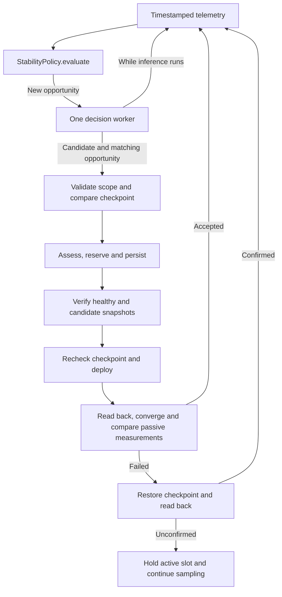

# Persistent autonomous controller

The controller keeps sampling after a successful repair or optimization. A policy permit starts one inference request. The controller reserves an intervention only after checking a typed candidate against the current opportunity. Baseline and candidate verification, configuration readback and measured runtime acceptance gate each write and success record.

The offline entry point runs on a laptop. Choose a new output directory.

```bash
.venv/bin/python -m advnet.controller_demo --output /tmp/comp7311-controller-demo
```

## Run live on Abilene

Start the lab and Batfish using the README. Run the controller from the repository
root on the Linux Docker host. The collector uses `nsenter` and `tc` from the
host and needs permission to open sockets in the lab host network namespaces.
Use the same OpenRouter and Batfish environment as for a bounded trial.

Start with a 30-second observation-only run.

```bash
sudo .venv/bin/python -m advnet.controller run --observe-only --duration 30s
```

For traffic experiments, establish TBF shaping on an otherwise idle lab. The
following uses the bounded harness's 100 Mbps default on each backbone link.
Run it before the controller and schedule. This deliberately replaces the
existing backbone qdiscs.

```bash
sudo .venv/bin/python -c 'import json; from advnet.lab import Deadline, Lab; Lab(json.load(open("topologies/abilene.json"))).shape({}, Deadline(120))'
```

The included workload runs for 20 minutes.

```bash
sudo --preserve-env=OPEN_ROUTER_KEY,LLM_MODEL,LLM_BASE_URL,BATFISH_HOST,SYSONE_MODEL \
  .venv/bin/python -m advnet.controller run --duration 20m --system-one jev \
  --workload experiments/continuous/sea-sva.json
```

- Choose `--system-one off` for LLM-only or `--observe-only` for a control arm
  that generates and measures the same traffic with inference and config
  deployment disabled. Start matched arms from the same lab config and shaping.
- The workload raises aggregate Seattle demand twice, with several minutes per
  plateau. Check the recorded maximum directed-link utilization and every
  receiver's delivery before and after an intervention. A quiet interval or
  an epoch transition cannot certify an optimization.
- Omit `--workload` for a repair-only run on a lab with no external data traffic.
  To exercise self-healing, wait for monitoring to start, inject a controlled
  Abilene fault from a separate terminal and record its wall-clock time. The
  first failed observation, policy permit, decision, and runtime outcome are
  timestamped independently. The launcher starts from a healthy reference and
  leaves accepted router changes in place.
- `--duration` accepts seconds or `s`, `m`, and `h` suffixes. The timed phase
  starts after preflight and calibration. The deadline or Ctrl+C ends the
  observation phase. A possible write gets its separate rollback budget and
  the launcher stops its traffic before releasing the lab lock.
- The default cadence is 10 seconds with six-second traffic windows. The
  connectivity sweep uses four workers and one ping per directed host pair.
  This limits simultaneous probe traffic while allowing failed pairs to time
  out during the window. The run records the worker count with its settings.
  Start a fresh output directory when changing the probe protocol so its
  healthy references use the same protocol as live validation. Allow
  enough time in each workload plateau for sustained detection, inference,
  Batfish, OSPF convergence, and both acceptance windows. Short plateaus can
  contribute telemetry without leaving enough time to validate a repair or
  optimization.

The launcher runs the existing schedule in the background under the same lab
lock as the controller. Dedicated, paced UDP sockets count matched packet
sequences at the receiver while traffic is active. Keep other data generators
and experiment runners off this lab during the run. The standalone iperf3
runner continues to use its own CLI. The collector checks the measured
sender rate, scopes health to the full directed host matrix and expected OSPF
adjacencies, and computes utilization from Linux interface counters and the
observed directional TBF rate.

Preflight records a healthy reference for each distinct workload composition
and rate. Live acceptance compares windows under that same demand and requires
an unchanged demand epoch and TBF fingerprint across the before/after pair.
For optimization, the before window must meet the policy's congestion
threshold and measured maximum utilization must fall by at least 5%, with
per-flow delivery and loss guardrails. This also allows pressure from a change
in offered demand at constant link capacity.

Inspect `events.jsonl` for timestamped observations, per-flow receiver
measurements, and decisions and outcomes. Each `sessions/<id>/` contains the
session summary and, for traffic runs, the schedule's clock origin and
execution log. Use `--output <dir> --resume` with the original manifest,
workload, and controller settings to reconcile a saved controller journal.
The new session starts its own workload timeline. Per-session sample totals
refer to that session, and outcome totals refer to the restored controller
history.

## Architecture



`PersistentController.run()` owns the state machine. The owner samples on a monotonic schedule and evaluates the actual stability policy. A separately spawned process calls the decision provider. Only the owner handles reservations, verification, writes and recovery. One intervention executes serially. Its verification, convergence and measurement can delay the next sampling tick. Inference allows sampling to continue.

The normal path runs through monitoring, evaluation pending, decision, proposal assessment, verification, deployment, runtime validation and cooldown. The controller also records rollback, recovery, blocked and stopped states. Clock time for scheduling and timeouts is monotonic. Evidence records and policy decisions use aware UTC timestamps.

## Integration interfaces

| Dependency | Contract |
| --- | --- |
| Telemetry | `telemetry(measurement_generation, deadline) -> Frame` returns its source, a `NetworkObservation`, and optional `Observation` for the decision engine. Missing aligned model input closes the opportunity. Collection errors invalidate pending evidence. |
| Policy | Supply a `StabilityPolicy` or use the default. Inject the same UTC clock into a custom policy and controller. The policy owns thresholds, hysteresis, retries, cooldowns, intervention frequency and reversal checks. |
| Decisions | `EngineProvider(llm, screener, catalog, threshold)` calls the existing `DecisionEngine.decide()`. Existing `LLM` and `Jev` adapters are compatible. Providers must be picklable for the production spawn worker. Initialize the controller under a Python main guard. |
| Executor | `VerifiedExecutor(lab, verifier, windows, scope, healthy_configs=...)` accepts the existing `Lab` transport and `ProcessVerifier`, plus a passive window reader and a trusted full healthy checkpoint. Its methods are `prepare`, `execute` and `readback`. |
| Time and cancellation | Inject a clock with `now()`, `monotonic()` and `wait(stop, seconds)`, and an Event-compatible cancellation signal. I/O providers must propagate the supplied deadline to blocking calls. |
| Persistence and recording | `Journal(directory)` implements exclusive ownership, atomic snapshot writes and JSONL events. A replacement journal supplies `root`, `owner()`, `load()` and `save(data)`. Pass `recorder(event)` to replace JSONL recording. |

A coordinator can construct the library directly once its collectors and verifier are configured.

```python
controller = PersistentController(
    Settings(mode="jev_llm", source="live", interval=5, duration=600),
    telemetry=collect_frame,
    decision=EngineProvider(llm, jev, catalog, threshold=0.9),
    executor=VerifiedExecutor(lab, batfish_verifier, read_runtime_window,
                              network_scope, healthy_configs=verified_baseline),
    journal=Journal(output_directory),
    cancel=stop_event,
)
controller.run()
```

The example accepts custom `collect_frame` and `read_runtime_window` functions. The live Abilene launcher supplies both through `LiveCollector`.

### Telemetry

`monitor_frame()` accepts the actual layout of `Monitor.sample()`. Each link produces two directed router/interface identities. Counter Mbps retains the snapshot timestamp. Calculating utilization requires attested effective capacity covering the entire counter interval. Pass the verified interval start and capacity validity range. An absent rate, unknown interval or nominal topology speed provides insufficient evidence. With a manifest, omitted monitored links are represented as unknown.

Supply independent `HealthMeasurement` values for the required host pairs and OSPF peers. A fingerprint must identify their scope and, for an aggregate failure, the affected members. Preserve the original measurement timestamp and generation when caching either check. Container status, offered UDP rates and an empty list of checks cannot establish health. Read the current policy generation at collection start. Reinitialize counter baselines on restart and collect fresh health checks. A caller that cannot establish which generation produced a reading must discard it.

With an Abilene manifest and a complete set of error-free, recent running configurations, the adapter can build a decision observation aligned to the telemetry envelope. The default configuration age limit is 30 seconds. Individual configurations retain their read times. Full readback checks them again before the controller uses a returned proposal. A caller can instead supply an aligned typed model observation directly.

### Inference and retries

LLM-only bypasses Jev. Jev+LLM uses the existing threshold, catalog routing, no-change handling and escalation on uncertainty or error. The worker receives the trigger kind, scoped evidence, opportunity ID and earlier feedback for this episode. Each permit starts at most one worker. Continuing observations retain or retire its token. Polling and proposal assessment use the latest policy state. Cancellation, opportunity invalidation, expiry or shutdown discards a late result. The POSIX worker has a hard timer and the owner kills and joins abandoned workers.

An episode groups attempts by impairment kind, affected signal keys and health scope. A rejection preserves feedback within that episode. An identical rejected patch cannot reenter verification in the same episode. Success, recovery or a new impairment starts a new decision history. The default limit is three model attempts per episode. Exhaustion is recorded and suppresses further calls for the episode. All policy cooldown and frequency rules still apply.

| Controller setting | Default |
| --- | --- |
| Mode and evidence source | Required. `llm_only` or `jev_llm`, and `synthetic` or `live` |
| Sampling interval / run duration | 5 s / 600 s |
| Inference timeout | 45 s, capped by opportunity expiry and remaining run time |
| Operation / rollback budget | 120 s / 180 s |
| Maximum attempts per episode | 3, configurable from 1 through 5 |

### Execution and passive measurement

1. Validate `Proposal`, check device/interface scope and materialize the typed patch using `candidate_configs`. Hash the complete configuration mapping before and after the change. The normalized patch hash identifies repeated actions.
2. Call `assess_proposal()` and `start_intervention()`. Persist the reservation and checkpoint before external verification. Verify both the supplied healthy configuration and the candidate using the complete manifest and existing snapshot format, including path policies.
3. Read the healthy and impaired runtime windows, then re-read the network checkpoint. Drift or missing evidence rejects the proposal. Apply configuration only to affected routers.
4. Require full configuration readback and healthy OSPF convergence. Obtain a passive window starting after convergence. Use the existing `acceptable()` or `acceptable_concurrent()` guardrails, then confirm the final candidate configuration again.
5. On failure after a possible write, use a separate cleanup deadline. A partial deployment can be restored if every router matches either its own checkpoint or its intended candidate configuration. Record each confirmed transition, including partial readback and rollback. An unknown third state or a failed restoration retains the active slot.

`windows(phase, kind, deadline)` returns a validated `RuntimeWindow` for `healthy`, `before` or `after`. All three need matching source, network scope, measurement duration, traffic scope and demand identity. The healthy baseline must match the verified baseline configuration. The before/after windows must match their configuration hashes, satisfy freshness checks and share a demand epoch. The producer must establish workload composition and rates over each whole window and change the epoch on every demand transition, including a change followed by a return to the original rate. A constant experiment ID cannot supply that evidence.

An active-traffic baseline must show positive receiver delivery for every reference flow. Single-flow acceptance uses measured receiver Mbps, loss and maximum link utilization. Concurrent acceptance checks measured sender overlap, matched per-flow profiles and receivers. Traffic-free repair requires explicit confirmed idle evidence. Optimization always requires measured traffic. The live launcher owns workload execution, and the executor consumes the resulting measurements. Incomparable evidence before deployment causes rejection. Incomparable evidence after deployment causes rollback.

### Persistence and evidence

Reuse the same private output directory when restarting a run. The controller stores a versioned policy snapshot, phase, mutation marker, episode history and binding to network scope, mode and evidence source. Each snapshot uses a temporary file, fsync and atomic replacement. Missing state in an occupied directory, corrupt state or an incompatible binding stops startup. A file lock excludes another owner of the same journal. The live launcher holds the existing Abilene experiment lock for its calibration, monitoring, and managed traffic.

On restart, `StabilityPolicy.restore()` retires an in-flight opportunity and preserves cooldowns and the active slot. An unfinished attempt requires current full readback matching its saved pre-change fingerprint. A confirmed unchanged pre-deployment attempt is recorded as failed. A checkpoint confirmed after a possible write resolves the rollback hold. A running candidate or unknown configuration remains blocked. Monitoring continues. Reconcile the network externally and restart the same journal to retry readback. A persistence failure propagates and leaves a held reservation available for reconciliation.

Each JSONL event has `version`, `at`, `source`, `mode`, `phase` and `event`. Observation rows include the timestamped measurements and full policy decision. Join decision, reservation, transition and outcome records by `opportunity` or `intervention` (inside policy decisions these are `opportunity_id` and `active_intervention_id`). Decision results contain routing, attempt context through the dispatch transition, call stages/models, token/cost accounting where available, and elapsed time. A killed worker may have incurred external usage that is unavailable locally. Proposal rows contain typed changes. Readbacks contain before/after hashes. Runtime results contain scoped measurement summaries, and outcomes include reasons and elapsed intervention time.

The run directory contains `controller.json`, `events.jsonl` and one directory per unique intervention attempt. Checkpoints and verifier snapshots contain configuration text and require private storage. Decision artifacts discard raw provider responses and free-form model prose. The durable policy snapshot is authoritative if a crash interrupts appending a timeline event.

## Offline results and live validation

The reproducible demo ran 100 sampling ticks. A single spike caused no inference. The first sustained impairment succeeded at 14.25 synthetic seconds. Sampling continued through cooldown. Independent later episodes produced verifier rejection at 34 s, confirmed rollback at 54.25 s and unconfirmed rollback at 74.25 s. The final 25 observations remained blocked. The four recorded configuration transitions reflect simulated readbacks. These data demonstrate controller behavior only.

```bash
.venv/bin/python -m unittest discover -s tests -p 'test_persistent_controller*.py' -v
.venv/bin/python -m unittest discover -s tests -p 'test_stability*.py' -v
RUN_BATFISH_INTEGRATION=0 RUN_TRAFFIC_INTEGRATION=0 RUN_DYNAMIC_TRAFFIC_INTEGRATION=0 .venv/bin/python -m unittest discover -s tests -p 'test_dynamic*.py' -v
RUN_BATFISH_INTEGRATION=0 RUN_TRAFFIC_INTEGRATION=0 RUN_DYNAMIC_TRAFFIC_INTEGRATION=0 .venv/bin/python -m unittest discover -s tests -v
.venv/bin/python -W error::SyntaxWarning -m compileall -q -f advnet tests scripts
.venv/bin/python scripts/scenario-suite.py validate
git diff --check
```

The controller tests exercise the real policy and execution state machine, process isolation, cancellation, duplicate suppression, configuration drift, partial writes, failed storage, shutdown and restart. Batfish verdicts, router operations, SDK responses and traffic measurements in those tests are synthetic.

The optional receiver test uses real UDP over Linux loopback. The cEOS smoke
test should also confirm the live collector cadence, router readback, Batfish
verdict, and checkpoint restoration on the actual topology.

```bash
RUN_CONTROLLER_SOCKET_TEST=1 .venv/bin/python -m unittest discover -s tests -p 'test_live_controller.py' -v
```
